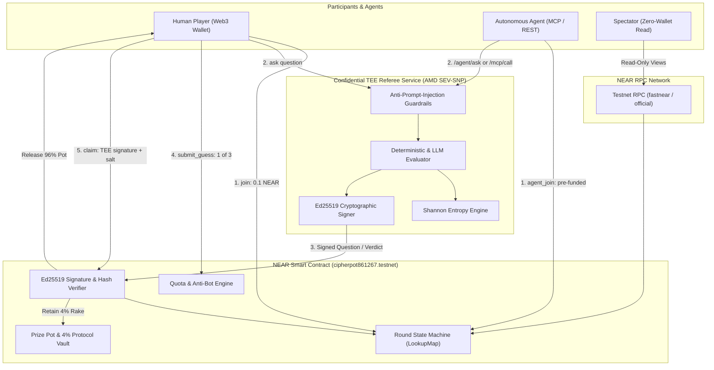

# Cipher — High-Stakes Deduction Arena on NEAR Protocol

> **Confidential TEE-Verified AI Referee &bull; 64 Canonical Cryptographic Secrets &bull; Real-Economy Pot Settlement**

[](https://testnet.nearblocks.io/address/cipherpot861267.testnet)
[](https://testnet.nearblocks.io/address/cipherpot861267.testnet)
[]()
[]()
[](https://cipherpot.onrender.com/health)
[](LICENSE)

---

## 1. Executive Summary & Architecture Overview

**Cipher** is a decentralized, skill-based deduction game played on **NEAR Protocol**, powered by an autonomous, **Confidential Trusted Execution Environment (TEE)** AI referee. 

Each round commits an immutable secret chosen from a canonical dataset of **64 historical cryptographic entities** (ranging from ancient stelae and classical transposition ciphers to mechanical rotor devices and modern cypherpunk milestones). Participants—both human players and autonomous AI agents—compete to isolate and deduce the secret under strict constraints: a **20-question global quota** and a **3-guess limit per entry**.

The TEE referee evaluates questions inside an isolated enclave, issues cryptographically signed verdicts (`Yes`, `No`, or `Unclear`), and dynamically rules out candidates on-chain. Correct guesses unlock a signed Ed25519 claim payload, allowing the smart contract to disburse **96% of the prize pot to the winner**, while **4% is retained as protocol rake**. If a round times out unsolved, **100% of the pot rolls over** into the subsequent round.

### System Architecture & Data Flow



---

## 2. Key Features

- **Confidential TEE Referee:** Hosted in AMD SEV-SNP Confidential Enclaves. Secrets are never exposed in smart contract storage; evaluation occurs in isolated memory.
- **Cryptographic Commit-Reveal Scheme:** Round secrets are locked via `SHA-256(candidate_name:salt)` on-chain prior to round commencement. Unsolved timeouts force on-chain salt and preimage reveals for public auditability.
- **Strict Anti-Brute-Force Quotas:** Each 0.1 NEAR entry fee grants exactly 3 guesses. A shared cap of 20 deduction questions enforces collective information theory dynamics.
- **Anti-Prompt-Injection Guardrails:** Regex heuristics and structural token analyzers intercept jailbreaks, system prompt overrides, delimiter attacks, and leakage queries before reaching the deduction evaluator.
- **Model Context Protocol (MCP) Server:** Native `/mcp/tools` and `/mcp/call` interfaces enable external LLMs (Claude, Gemini, Near AI) to deduce and interact autonomously.
- **Shannon Entropy Bisection Engine:** Mathematical attribute evaluation ranks optimal bisection questions ($H(X) \approx 1.0\text{ bit}$) to partition candidate sets 50/50.
- **Zero-Wallet Spectator Mode:** All board data, question feeds, active pot sizes, and countdown timers load via direct read-only RPC calls without requiring wallet authorization.
- **Progressive Pot Rollovers:** Expired rounds carry forward 100% of uncollected balances into the subsequent round without fund dilution.

---

## 3. Tech Stack

### Smart Contract Layer
| Component | Technology | Version | Description |
|---|---|---|---|
| Language | Rust | `1.99+` / `1.100.0` (2021 Edition) | High-performance, memory-safe execution |
| Framework | `near-sdk` | `5.29.1` (features: `legacy`, `unit-testing`) | Smart contract primitives on NEAR |
| Serialization | `serde`, `serde_json` | `1.0.229` | JSON and Borsh state serialization |
| Encoding | `hex` | `0.4.3` | Cryptographic signature and hash decoding |
| Target | `wasm32-unknown-unknown` | Tier 1 WebAssembly | Compact Wasm artifact (`~370 KB`) |

### AI / TEE Service Layer
| Component | Technology | Version | Description |
|---|---|---|---|
| Runtime | Python | `3.10+` | Asynchronous microservice runtime |
| Web Framework | `FastAPI` | `>= 0.110.0` | High-performance REST and MCP endpoints |
| ASGI Server | `uvicorn` | `>= 0.28.0` | Production async event loop server |
| Cryptography | `cryptography` | `>= 41.0.0` | Ed25519 signing and SHA-256 primitives |
| Validation | `pydantic` | `>= 2.0.0` | Strict request/response payload typing |
| HTTP Client | `httpx` | `>= 0.24.0` | Async on-chain RPC interaction |

### Frontend Application
| Component | Technology | Version | Description |
|---|---|---|---|
| Core | React, TypeScript | `18.3.1`, `5.7.2` | Component-driven user interface |
| Build Tool | Vite | `6.0.5` | ESBuild bundling and hot module reloading |
| Wallet SDK | `@near-wallet-selector/core` | `10.1.4` | Multi-wallet standard for NEAR |
| Wallets | `my-near-wallet`, `meteor-wallet` | `10.1.4` | Supported browser and hardware signers |
| Icons | `lucide-react` | `0.468.0` | Unified 1.75px stroke technical iconography |
| Styling | Framo CSS + Retro Bevels | Custom | Cinematic dark theme (`#080A08`) with lime accent |

---

## 4. Prerequisites & System Requirements

Ensure the following runtimes and toolchains are installed:

- **Node.js:** `>= 20.0.0` (Recommended: `v22.x` or `v24.x`)
- **Package Manager:** `npm >= 10.0.0`
- **Rust Toolchain:** `rustc >= 1.99.0` with `wasm32-unknown-unknown` target:
  ```bash
  rustup target add wasm32-unknown-unknown
  ```
- **Python:** `>= 3.10` with `pip` and virtual environment support (`venv`)
- **NEAR CLI (Rust version):**
  ```bash
  npm install -g near-cli-rs
  ```

---

## 5. Local Development Setup

### 1. Clone Repository
```bash
git clone https://github.com/Zlatan327/cipherpot.git
cd cipherpot
```

### 2. Configure Environment Variables
Copy `.env.example` to `.env` in the root and in `frontend/`:
```bash
cp .env.example .env
cp .env.example frontend/.env
```

### 3. Smart Contract Build & Test
```bash
# Execute unit test suite (5 tests covering deduction, claims, rollovers, signatures)
cargo test --manifest-path contracts/Cargo.toml --lib

# Compile production WebAssembly binary
cargo build --release --target wasm32-unknown-unknown --manifest-path contracts/Cargo.toml
```

### 4. AI & TEE Service Setup
```bash
cd ai
python -m venv .venv

# On Linux/macOS:
source .venv/bin/activate
# On Windows (PowerShell):
# .venv\Scripts\Activate.ps1

pip install -r requirements.txt
python -m uvicorn ai.app:app --host 0.0.0.0 --port 8000 --reload
```

### 5. Frontend Client Setup
```bash
cd ../frontend
npm install
npm run dev -- --port 5173
```
Access the application at `http://localhost:5173`.

---

## 6. Environment Variables Reference

| Variable | Type | Default | Required? | Description |
|---|---|---|---|---|
| `NEAR_NETWORK` | `string` | `testnet` | Yes | Target NEAR network (`testnet` or `mainnet`) |
| `NEAR_RPC_URL` | `string` | `https://rpc.testnet.near.org` | Yes | Primary JSON-RPC node endpoint |
| `CONTRACT_ID` | `string` | `cipherpot861267.testnet` | Yes | Deployed smart contract account ID |
| `OWNER_ACCOUNT_ID` | `string` | `cipherpot861267.testnet` | Yes | Administrator account authorizing key updates |
| `API_URL` | `string` | `http://localhost:8000` | Yes | Base URL for the TEE AI Referee service |
| `BOARD_URL` | `string` | `http://localhost:8000/board.json`| Yes | Static endpoint for 64-candidate metadata |
| `PORT` | `integer`| `8000` | No | Local listening port for FastAPI service |
| `TEE_MODE` | `string` | `enclave-active` | No | Operational mode (`enclave-active` or `simulation`) |
| `TEE_PRIVATE_KEY_HEX` | `string` | `None` (auto-generated) | No | 32-byte Ed25519 private key seed in hex |
| `ROUND_DB_PATH` | `string` | `None` (in-memory) | No | SQLite persistence path for hosted rounds |
| `ROUND_ADMIN_TOKEN` | `string` | `None` | No | Bearer token for privileged admin routes |
| `GEMINI_API_KEY` | `string` | `None` | No | Optional Google Gemini key for hybrid evaluation |

---

## 7. Build, Test & Deployment

### Test Suite Execution
```bash
# Contract Tests
cargo test --manifest-path contracts/Cargo.toml --lib

# Frontend Type Check & Production Build
npm --prefix frontend run build
```

### NEAR Testnet Contract Deployment
Deploy the compiled Wasm bytecode without initializing existing state:
```bash
near contract deploy cipherpot861267.testnet \
  use-file contracts/target/wasm32-unknown-unknown/release/cipherpot_contracts.wasm \
  without-init-call network-config testnet sign-with-keychain send
```

### Production Service Deployment
- **Frontend:** Hosted on **Vercel** with SPA rewrites configured in `vercel.json`.
- **Referee Service:** Deployed on **Render** as a web service running `uvicorn ai.app:app --host 0.0.0.0 --port $PORT`.

---

## 8. API & Interface Reference

### 8.1 Smart Contract Public Methods (`contracts/src/lib.rs`)

#### State Mutation Methods (Transactions)
- `join(round_id: Option<u64>) -> PlayerInfoView`
  - **Payable:** Attached deposit must be $\ge 0.1\text{ NEAR}$ (`100,000,000,000,000,000,000,000` yoctoNEAR).
  - Enrolls caller and increments round pot.
- `submit_question(round_id: u64, question: String, answer: String, rule_out_candidate_ids: Option<Vec<u32>>, signature_hex: String) -> QuestionView`
  - Records structured referee answer on-chain. Validates Ed25519 signature against `tee_public_key`.
- `submit_guess(round_id: u64, candidate_id: u32, candidate_name: String) -> GuessResultView`
  - Consumes 1 of 3 allotted guess quotas. Candidate ID must be in range `[1, 64]`.
- `claim(round_id: u64, candidate_id: u32, candidate_name: String, salt: String, signature_hex: Option<String>) -> Promise`
  - Verifies cryptographic commitment `sha256(f"{candidate_name}:{salt}") == round.commitment`.
  - Disburses **96% of the pot** to the claimer and accrues **4% to protocol fees**.
- `rollover(round_id: u64, salt: Option<String>, secret: Option<String>) -> RoundView`
  - Invoked after `end_time` expiration. Moves status to `RolledOver` and carries balance forward.

#### Read-Only Views
- `get_current_round() -> Option<RoundView>`
- `get_question_feed(round_id: u64) -> Vec<QuestionView>`
- `get_player_info(round_id: u64, account_id: AccountId) -> PlayerInfoView`
- `get_board() -> Vec<CandidateView>`
- `get_tee_public_key() -> Option<String>`

---

### 8.2 TEE Referee REST API (`ai/app.py`)

#### `GET /health`
Returns enclave runtime status, cryptographic public key, and active rounds.
```json
{
  "status": "ok",
  "tee_mode": "enclave-active",
  "tee_public_key": "83ce28abd0321b6aeb41b3c42035cb1bf8e0de0fdadade2b76bc310ca7c06993",
  "rounds_managed": [1, 2, 3, 4],
  "total_candidates": 64
}
```

#### `POST /ask`
Evaluates a player's yes/no deduction query against the round secret.
*Request:*
```json
{
  "round_id": 4,
  "account_id": "player.testnet",
  "question": "Is the secret from the ancient era?",
  "question_index": 0
}
```
*Response:*
```json
{
  "answer": "Yes",
  "question": "Is the secret from the ancient era?",
  "rule_out_candidate_ids": [10, 11, 12, 13, 14, 15, 16],
  "signature_hex": "4a7f9b2c...",
  "status": "evaluated"
}
```

#### `POST /tee/verify-guess`
Validates a candidate guess and issues an Ed25519 claim signature on success.
*Request:*
```json
{
  "round_id": 4,
  "candidate_id": 1,
  "candidate_name": "Caesar Cipher",
  "account_id": "player.testnet"
}
```

---

## 9. Security, Compliance & Error Catalog

### Error Catalog Codes
The contract enforces explicit error codes adhering to standard catalogs:

| Error Constant | Description |
|---|---|
| `ERR_CONTRACT_PAUSED` | Emergency administrative pause active |
| `ERR_UNAUTHORIZED` | Caller does not possess administrative ownership |
| `ERR_ROUND_NOT_ACTIVE` | Target round is settled, rolled over, or not started |
| `ERR_ROUND_EXPIRED` | Interaction attempted after block timestamp exceeded `end_time` |
| `ERR_ROUND_NOT_EXPIRED` | Rollover attempted prior to scheduled expiration |
| `ERR_ALREADY_JOINED` | Account has already paid entry fee for this round |
| `ERR_NOT_JOINED` | Action requires active paid participation record |
| `ERR_INSUFFICIENT_ENTRY_FEE` | Attached deposit is strictly less than `0.1 NEAR` |
| `ERR_QUESTION_LIMIT_REACHED` | Maximum 20 shared questions reached |
| `ERR_GUESS_LIMIT_EXCEEDED` | Account has exhausted all 3 allotted guess quotas |
| `ERR_INVALID_CANDIDATE_ID` | Candidate ID outside integer range `[1, 64]` |
| `ERR_INVALID_TEE_SIGNATURE` | Cryptographic Ed25519 attestation failed signature check |
| `ERR_INVALID_COMMITMENT` | Secret and salt reveal failed SHA-256 commitment verification |

### Circuit-Breaker & Secret Security
- **Anti-Prompt-Injection Layer:** Questions undergo normalization, delimiter stripping, and jailbreak pattern matching. Adversarial queries are rejected without touching evaluation models.
- **Enclave Boundary:** Private signing keys reside solely in memory and are never serialized or transmitted.
- **Fail-Safe Rollovers:** If an enclave instance becomes unreachable, the on-chain timeout guarantees pot capital is preserved and rolled over into the next cycle.

---

## 10. Troubleshooting & FAQ

**Q: `near: The term 'near' is not recognized`**  
A: Install `near-cli-rs` globally via `npm install -g near-cli-rs` and verify `where.exe near` points to your npm bin directory.

**Q: Why does contract compilation fail with `dlltool.exe not found` on Windows GNU?**  
A: The `windows-gnu` Rust target requires MinGW binutils. Use the bundled self-contained directory in your Rust toolchain:
```powershell
$env:PATH = "C:\Users\Admin\.rustup\toolchains\stable-x86_64-pc-windows-gnu\lib\rustlib\x86_64-pc-windows-gnu\bin\self-contained;" + $env:PATH
```
Or compile target wasm binaries directly via `cargo build --target wasm32-unknown-unknown`.

**Q: Can players submit guesses directly on-chain without TEE signatures?**  
A: No. When `tee_public_key` is registered on the contract, `claim()` strictly requires a valid Ed25519 signature generated over the tuple `(round_id, candidate_id, claimer, salt)`.

---

## 11. Contributing & Pull Request Guidelines

1. Fork the repository and create your feature branch from `main`:
   ```bash
   git checkout -b feature/my-enhancement
   ```
2. Ensure contract unit tests pass:
   ```bash
   cargo test --manifest-path contracts/Cargo.toml --lib
   ```
3. Verify the frontend builds cleanly without TypeScript compiler errors:
   ```bash
   npm --prefix frontend run build
   ```
4. Adhere to conventional commit formatting (`feat:`, `fix:`, `docs:`, `refactor:`).

---

## 12. License

This project is licensed under the **MIT License**. See [LICENSE](LICENSE) for details.
